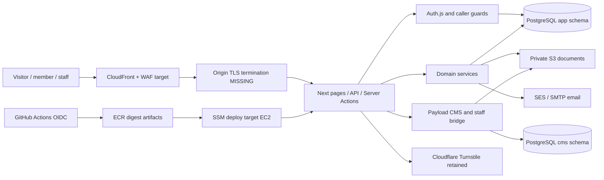

# Project inventory and architecture
Date/baseline and verification conventions: [10](10-evidence-and-verification-log.md). References are repository-relative paths with one-based source lines where supplied. Documents establish recorded intent, not live facts.

## Purpose, users and outcomes
README and `docs/PRODUCT_ARCHITECTURE.md:11–67` describe a digital front door and operating layer for KIIT's innovation ecosystem. The core job is to help a visitor find their stage, discover relevant programs and participate, while staff publish and make accountable decisions. Personas in `docs/USER_JOURNEYS.md:13–21`: curious student, applicant, accepted founder, mentor, investor, partner and staff. Later scope adds lab members/heads/assistants/administrators. There is no payment, banking, balance, reconciliation or financial transaction engine in inspected code; banking-specific obligations are not inferred.

Success must mean usable journeys and operational outcomes, not just populated pages. Basic candidate metrics: onboarding completion, verified submissions, staff response/decision lead time, application failure rate and enquiry response time. Existing event counts are not cohort conversion (F20).

## Repository and history
- Single application package, not a service monorepo. `package.json` version 0.1.0, private ESM package; pnpm 10.33.0; `pnpm-lock.yaml` and `pnpm-workspace.yaml`.
- Audit working-copy inventory: **793 tracked/untracked nonignored files** copied with hashes; ignored environment/dependency/build trees excluded. A copied generated `next-env.d.ts` permits type checking without touching the original.
- Source: `src/app`, `src/server`, `src/components`, `src/db`, `src/payload`, `src/migrations`, `src/lib`, `src/styles`.
- Delivery/acceptance: `docs/delivery`; historical plans/retrospectives under `docs`; staff/runbook material under `docs/handover`; prior forensic report under `docs/audit/2026-10-08-forensic-audit.md`.
- Infrastructure: `Dockerfile`, `docker-compose.yml`, `infra/cfn/{app,edge,dns,cert,waf,ci}.yaml`, `infra/s1`, `infra/edge`.
- Verification: `tests/integration`, `tests/support`, colocated `src/**/*.test.ts`, `infra/**/*.test.ts`, `scripts`, `.github/workflows/{ci,release-image}.yml`.
- Root `tokens`, `components`, `workflows`, `frameworks`, `design-systems`, `accessibility`, `taste` contain extensive design/process reference material. They are not independent runtime services; their presence does not prove a live token pipeline or product acceptance.
- Root AGENTS.md instructs reading installed Next guides before code. Relevant installed Next data-security/output guides were inspected; no product code was written.
- Branch `delivery/p1-containment`, HEAD `27d3dcd…`; remote `https://github.com/KNEST-KIIT/knest.git`, PUBLIC. GitHub default branch is `claude/knest-ecosystem-platform-g9erjs`, not the audited branch.
- Original architecture commit `069a282` (29 August 2026); major October 9 changes include security/production environment (`7798fe9`), AWS IaC/CI (`83143e2`), public/staff workflows (`4cc8fbb`), labs (`1427180`), migration-test adjustment (`1fc5fcc`), IaC constraints (`fac5d49`), handover/deploy restore point (`27d3dcd`).
- GitHub issue/PR lists returned empty visible open results. This does not establish no closed/private/off-repository requirements.

## Exact manifest stack
| Layer | Declared version/tool | Notes |
|---|---|---|
| Runtime | Node 24 in CI/container; local v24.16.0 | README says Node22+; reproducible release should pin agreed runtime |
| Framework | Next 16.4.0, React/React DOM ^19.2.8 | App Router, proxy, standalone output outside Vercel |
| Language | TypeScript ^5.9.3 | strict and noUncheckedIndexedAccess |
| CMS | Payload and related packages 3.90.2 | PostgreSQL adapter, Lexical, S3 storage |
| Operational data | Drizzle ^0.45.2, pg ^8.23.0 | Separate `app` schema |
| Authentication | next-auth 5.0.0-beta.32, Drizzle adapter | Database sessions; custom password session minting |
| UI | Tailwind 4.3.3, Framer Motion 13.1.1 | CSS tokens and reusable components |
| Validation/security | Zod 4.5.2, bcryptjs 3, file-type 22 | Validation, password hashes, byte sniffing |
| External SDKs | AWS S3/SESv2, nodemailer 10 | Role credentials planned; SMTP used in tests |
| Verification | Vitest 4.1.11, Playwright 1.62.1, axe 4.13 | Real PG16 fixtures; external services stubbed |
| Local database | embedded-postgres 16.14.0-beta.17 / Docker PG16 | Disposable integration environment |

Manifest ranges are not necessarily exact installed transitive versions. Overrides and accepted advisory IDs live in pnpm-workspace.yaml. No dependency install was performed.

## System map

AWS nodes describe configuration/target design, not observed deployed resources. Vercel currently provides the observed maintenance presence.

## Data and trust flow
1. Public content readers call Payload and return published records; genuine empty states are supported. CMS contents include programs/cohorts/startups/founders/mentors/partners/events/resources/articles/infrastructure/testimonials/FAQs/metrics/media/staff and Homepage global.
2. Operational accounts have one `app.users` record with platform role and optional staff role. Auth.js session lookup re-reads current role/active state. Payload mirrors authenticated staff into `cms.staff`; this is an identity bridge, not a separate human login.
3. Password signup creates a session before verification, preserving low-friction onboarding. Verified email is enforced for application submission. Password reset/verification tokens are hashed and purpose-scoped.
4. Application start stores a CMS program ID in `app.applications`; answers are keyed by CMS question row ID. Submission freezes question definitions; answers, documents, status, audit and notification behavior use operational tables.
5. Operational tables cover users/accounts/sessions/verification tokens; applications/answers/document metadata; notifications/audit; event registrations; enquiries; analytics/rate limits; labs/hours/blackouts/staff/bookings/manual attendance. Schema and migrations are source evidence, not a dump of a persistent database.
6. Cross-schema references deliberately use stable IDs and service lookups instead of database FKs. Program deletion guard reduces orphaning, but migration/populated-data rehearsal remains necessary.
7. Upload: authenticate/validate → object write → metadata transaction. This ordering and question validation create F12. Document download is authenticated and forced attachment; CMS media has separate publication concerns.
8. In-app notification changes often share domain transactions; email is sent after commit with no durable retry (F13). Events commit registration before writing notification.
9. Page-worker Server Actions form an additional POST boundary beside API routes. Page guards do not authorize those endpoints. F01 is runtime-confirmed locally. F02's auth exports occur only in API-route workers: registration alone did not establish a second callable auth path, and the bypass hypothesis was withdrawn.

## Fit, scalability and debt
A modular monolith fits the evidence and provisional pilot workload. Keep shared PostgreSQL and object storage; no evidence justifies microservices, Kubernetes, Redis or a rewrite. Main coupling risks are dual framework/database pools, identity bridge, cross-schema references, and endpoint ambiguity. Centralize caller checks/DTOs and invariants rather than redesigning service boundaries.

Post-V1 candidates: batch event-content reads (current per-registration lookup), bounded list pagination, analytics/session/rate-table cleanup, pool sizing based on measured connections, token lint/design polish. Cleanup required by approved privacy policy is not optional performance debt.

No durable worker, queue, reminder/expiry scheduler, load benchmark, capacity proof, APM/tracing or live alert drill was found. These absences have differing priorities: a tiny DB-backed notification retry and retention task can satisfy V1 without another platform.

## Uninspectable systems
Current AWS resource inventory, scoped IAM identity, billing/credit state, RDS data, backups, S3 policy/runtime usage, SES quota/identity, Vercel dashboard aliases/settings, registrar ownership, full DNS zone, protected GitHub Environment reviewers and the commercial document received by KIIT were not inspected. Do not substitute historical account notes for fresh cloud evidence.

