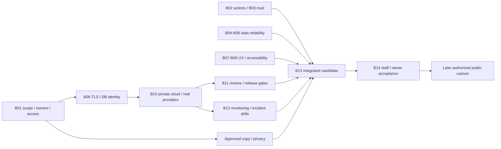

# Estimates, roadmap and critical path

## Method and assumptions

Backlog B01–B14 in [08](08-prioritized-backlog.md) is deduplicated. Estimates include implementation, review and focused regressions; B13 covers harness and final acceptance without charging regression writing twice. A person-day is one engineer's full working day.

Assume repository-familiar TypeScript/Next/Payload/Postgres engineers, five working days per week, a small institutional pilot and no scope expansion. Owner/legal/provider waiting is additional and unbounded. No completion percentage is used.

## Engineering effort

| Workstream | Backlog | Low | Likely | High person-days |
|---|---|---:|---:|---:|
| Scope/inputs and handover | B01+B14 | 2 | 4 | 7 |
| Endpoint security and deployment trust | B02+B03 | 4 | 7 | 12 |
| Data, upload and notification reliability | B04+B05+B06 | 4 | 7 | 13 |
| UX and accessibility | B07+B08 | 3 | 6 | 10 |
| Cloud, TLS, identity and real providers | B09+B10 | 4 | 8 | 14 |
| Release, recovery and operations | B11+B12 | 4 | 7 | 12 |
| Risk harness and final acceptance | B13 | 3 | 5 | 8 |
| **Application-first total** | **B01–B14** | **24** | **44** | **76** |
| Manual lab booking addition | B15–B17 | 6 | 11 | 20 |
| **Application + manual labs** | | **30** | **55** | **96** |

B18–B22 optional mentor/profile, analytics, history assurance, measured polish and latent auth-boundary cleanup are excluded. QR/PWA/offline/scanning require scope, device and security decisions before estimation; exclusion does not settle contractual obligations.

Provisioning B10 alone is **2/4/7 person-days**. Full cloud/release/operations B09–B12 is **8/15/26**, already included in the total. Do not add this subtotal again.

The F02 CAPTCHA-bypass hypothesis was withdrawn after runtime counterevidence. B02 still contains reproduced broad reader, DTO and draft-isolation repairs. Retaining its provisional range reflects that actual work, rather than continuing to charge for a nonexistent confirmed exploit.

## Calendar scenarios

| Scope / staffing | Low | Likely | High |
|---|---:|---:|---:|
| Application V1, one full-time developer | 6 weeks | 11 weeks | 19 weeks |
| Application V1, practical three-person team | 4 weeks | 6 weeks | 10 weeks |
| Application + manual labs, one developer | 7 weeks | 14 weeks | 24 weeks |
| Application + manual labs, three-person team | 5 weeks | 8 weeks | 13 weeks |

One-person application timing uses 24/44/76 working days plus approximately 15/20/25% calendar contingency, rounded. The three-person scenario assumes backend/security/data, frontend/product/accessibility, and SRE/release engineers, with peer review and QA coordination. It accounts for serial provider, integrated-candidate, restore and acceptance work; it is not total effort divided by three.

Institutional staff supply policy/content/domain acceptance and a manual accessibility reviewer is available. Reduced allocation, holidays, new defects and approval waits extend elapsed time. No unconditional launch date is supportable.

## Critical path and parallel work

After separate implementation authorization, endpoint, data and frontend repairs can proceed concurrently with cloud design. Provisioning depends on scoped access, budget and TLS choice. Actual provider/rotation/restore/alert proof requires the private environment. Final candidate tests depend on integrated fixes. DNS/mail cutover waits for every applicable gate and explicit release authorization.

Likely three-person sequence:

- Weeks 1–2: approve scope and inputs; repair boundaries/atomicity/forms; resolve TLS and database roles; authorized disposable capacity proof.
- Weeks 2–3: uploads/delivery retries/accessibility; private hosting and providers; early test-selector, fixture, flag and drift repairs.
- Weeks 3–4: integrated candidate, real services, release gates, populated upgrade, restore and rotation.
- Weeks 5–6: negative/failure/load/manual acceptance, delivered alarms, support/staff exercise and release manifest.

Provider and institution waits can stretch these phases without consuming equivalent engineering days.

## Fastest responsible and recommended paths

The fastest path keeps labs off, optional Google login off until accepted, a few real staffed programs and truthful limited content. Repair authorization first; use existing concurrency/happy-path tests; choose one complete origin TLS design and a minimal database delivery retry task.

The **24-day low bound** assumes ready inputs, familiar engineers, narrow repairs and no substantial new findings. It leaves only 16 days outside the 8-day operations subtotal and is optimistic. A private synthetic pilot may occur sooner; it does not authorize real student data collection.

The recommended robust plan is the **44-day likely case**, followed by separate lab acceptance if selected. Do not accelerate by skipping privacy, authorization, recovery or real-provider gates.

## Hosting costs and assumptions

Planning region: ap-south-1 (Mumbai), 730 hours/month. Assumed initial sizing: EC2 t4g.small (2 GiB) only if measured capacity passes, Single-AZ RDS db.t4g.micro, 20 GB each EBS/RDS, small object/log volumes, up to 1 million requests and 10,000 transactional messages/month. Credits are not deducted. Tax, domain renewals, support and labour are separate.

Exact compute/RDS rates in AWS-PRODUCTION-BUDGET are repository estimates, not freshly recomputed account quotes. A current regional calculator and sizing proof are required before purchase.

| Scenario | Planning USD/month | Caveat |
|---|---:|---|
| Existing baseline before complete origin TLS | 45–51 | Repository already acknowledges required TLS addition |
| Proved host TLS plus operational additions | 50–70 | Certificate renewal, patching and availability ownership required |
| ALB + regional ACM TLS | 75–110 | Recommended when host TLS renewal/ownership cannot be proved; includes ALB/LCU, IPv4 and small omissions |
| More memory / Multi-AZ envelope | 100–160+ | Depends on measured sizing and selected redundancy |
| Disposable S-1 | Previously recorded USD 25 total ceiling | Authorization limit, not an automatic billing cap; audit provisions nothing |

Budget corrections and sources:

- Template contains four application secrets plus the RDS secret; the older budget counts one. Four extra secrets at USD 0.40 add approximately USD 1.60/month. [Secrets Manager pricing](https://aws.amazon.com/secrets-manager/pricing/).
- Public IPv4 is USD 0.005/hour, approximately USD 3.65/address/month; two ALB addresses add about USD 7.30 before allowances. [VPC pricing](https://aws.amazon.com/vpc/pricing/).
- ALB hours and LCUs are additional to compute; obtain a Mumbai quote for the complete topology. [Load balancer pricing](https://aws.amazon.com/elasticloadbalancing/pricing/).
- Published SES outbound à la carte pricing is USD 0.10/1,000 messages, approximately USD 1 at 10,000 messages; attachment, feature, account-plan and access/delivery conditions remain separate. [SES pricing](https://aws.amazon.com/ses/pricing/).
- Manual snapshots need bounded retention. S3 versions, logs, DNS, backups and alarm usage can exceed pilot assumptions.
- CloudFront flat-rate plans now bundle selected services; compare custom WAF/routing/region/account compatibility before assuming savings. [CloudFront plan documentation](https://docs.aws.amazon.com/AmazonCloudFront/latest/DeveloperGuide/flat-rate-pricing-plan.html).

Report 06 compares host TLS, ALB and Lightsail. Preserve the recorded AWS-only and no-permanent-staging decisions. No existing credentials, records or accounts should be changed merely because a cost comparison exists.

Staffing cost is **24/44/76 × agreed blended person-day rate**. At a purely illustrative USD 250/day, that is USD 6,000/11,000/19,000; arithmetic only, not a market quote. Institutional review, ongoing operators and optional scope are extra.

## Uncertainty and reduction

Largest unknowns: received contract/variation; institutional approvals; cloud/account/DNS control; SES access; memory and pool capacity; populated historical data; remaining callable boundaries; accepted recovery targets; and manual accessibility defects.

Reduce uncertainty with approved scope, an authorized read-only cloud inventory, early capacity/TLS/provider proof, synthetic boundary regressions and a restore drill. Narrow optional scope and parallelize bounded repairs; retain integration and review gates.