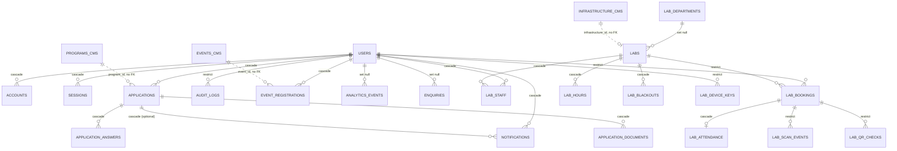

# E4.01 The two schemas, and the conventions inside them

Scope: why the database is split into `app` and `cms`, who owns each, how the two are allowed to
refer to each other, and the column conventions every `app` table follows.

## 1. One PostgreSQL database, two schemas, two owners

| Schema | Owner of the DDL | Holds | Migration tool | Migration location |
|---|---|---|---|---|
| `app` | Drizzle ORM / drizzle-kit | Operational and personal data: accounts, applications, labs, notifications, audit, mail, rate limits | Drizzle (`src/db/migrate.ts`) | `src/db/migrations/0000..0013` |
| `cms` | Payload CMS (`@payloadcms/db-postgres`) | Editorial content: programs, startups, mentors, events, media, the homepage global, the staff mirror, Payload's own bookkeeping | Payload (`payload migrate`) | `src/migrations/` |
| `drizzle` | Drizzle migrator | Bookkeeping table `__drizzle_migrations` only | Drizzle | created by the migrator |

Evidence:

- `src/db/schema/enums.ts:4-11` declares `appSchema = pgSchema('app')` and states the rule: "Payload owns
  the `cms` schema ... Nothing in this file may be duplicated into a Payload collection: cross-schema
  references are by stable ID and are resolved in `src/server/services/`, never by joining across
  schemas inside a page component."
- `src/payload/payload.config.ts:101-112` pins Payload to `schemaName: 'cms'`, sets `push: false` and
  `migrationDir: path.resolve(dirname, '../migrations')` (that is `src/migrations`).
- `drizzle.config.ts:10` sets `schemaFilter: ['app']` with the comment "Restricting drizzle-kit to
  `app` stops it from trying to drop Payload's tables."
- `src/db/migrate.ts:5-17` passes `migrationsSchema: 'drizzle'`. The comment explains why: if the
  bookkeeping table lived in `app`, the migrator would create `app` before migration 0000, whose own
  `CREATE SCHEMA "app"` (`0000_amused_namor.sql:1`) would then fail.

### Why the split exists (the invariants)

1. **Independent migration histories.** Payload generates DDL from collection config; Drizzle
   generates it from `src/db/schema`. If one tool owned both, either tool could emit `DROP TABLE` for
   the other's tables. The `schemaFilter` and `schemaName` settings make that impossible by
   construction. A change to a collection config requires a Payload migration; a change to an
   operational table requires a Drizzle migration; they never need to be sequenced together.
2. **Different privacy and access regimes.** `cms` content is public by design (`access.read` is
   public for published documents, `src/payload/access.ts:32-35,46`). `app` data is personal or staff
   data and is only reachable through server code that checks a session. The comment on
   `src/db/schema/enquiries.ts:8-13` makes this explicit: contact-form messages are personal data and
   "belong with the other member data under the same access rules and retention decisions".
   `src/payload/collections/startups.ts:7-14` repeats it for startups: "Private operational data ...
   belongs in the app schema and must never be added to this collection".
3. **One account system.** There is no Payload-owned users table. `cms.staff` is a shadow mirror of
   staff rows from `app.users` (see `16-auth-bridge.md`).
4. **Least privilege at the database role.** `src/db/runtime-role.ts:19,42-52` grants the web
   runtime role DML only, on exactly `app` and `cms`, and revokes the `drizzle` schema
   (`runtime-role.ts:54`). See `09-client-pooling-ssl-and-roles.md`.

## 2. Cross-schema references: plain ids, never foreign keys

Postgres foreign keys cannot be created by Drizzle to Payload tables without coupling the two
migration histories. The code therefore stores Payload document ids as plain columns and enforces
integrity in application code or in a Payload hook.

| `app` column | Refers to (cms) | Type | Where integrity is enforced |
|---|---|---|---|
| `applications.program_id` | `cms.programs.id` (serial integer) | `integer NOT NULL` (`applications.ts:24`) | Existence checked before a draft is created, `src/server/applications/actions.ts` (comment `applications.ts:8-14`); delete blocked by Payload `beforeDelete` hook on Programs (`programs.ts:39-59`) |
| `event_registrations.event_id` | `cms.events.id` | `integer NOT NULL` (`events.ts:25`) | Application code in `src/server/events/actions.ts`; no delete guard on Events was found (see defects file) |
| `labs.infrastructure_id` | `cms.infrastructure.id` | `integer`, nullable, unique (`labs.ts:57,79`) | Application code only; no guard on Infrastructure deletion was found |
| `application_answers.question_id`, `application_documents.question_id` | the row id Payload assigns to an entry of `programs.applicationQuestions` (`cms.programs_application_questions.id`, a `varchar`) | `text NOT NULL` | Application code resolves the question from the program at write time (`actions.ts:126,175`); `applications.question_snapshot` freezes the questions at submit (migration 0007) |

The reverse direction (cms to app) also exists, as loose text ids:

| `cms` field | Refers to | Note |
|---|---|---|
| `founders.userId` (`founders.ts:32-40`) | `app.users.id` | `varchar`, indexed, no FK, optional |
| `mentors.userId` (`mentors.ts:60-69`) | `app.users.id` | `varchar`, indexed, no FK, optional |

Consequence worth stating for an operator: deleting a Program, Event or Infrastructure document in
the CMS can leave `app` rows pointing at a missing id. Only Programs has a guard that refuses when
applications exist.

## 3. Column conventions in `app`

Observed in every table definition under `src/db/schema/`:

- **Primary key**: `text` holding a UUID generated in application code,
  `$defaultFn(() => crypto.randomUUID())` (for example `users.ts:22-24`). It is not a database
  default; a raw SQL insert must supply the id. Exceptions: `sessions.session_token`,
  `rate_limits.key`, `lab_device_keys.id` (derived from the key), `lab_scan_events.id` (device-chosen
  UUID, the idempotency key), and the composite keys on `accounts` and `verification_tokens`.
- **Timestamps**: `timestamp with time zone`, mapped to JS `Date`
  (`{ mode: 'date', withTimezone: true }`). `created_at` and `updated_at` default to `now()` in the
  database. `updated_at` has no trigger: application code sets it on update (for example
  `src/server/members/actions.ts:54`). A raw SQL update that omits it leaves it stale.
- **Calendar dates**: only `lab_blackouts.starts_on/ends_on` use `date`, mapped to `string`
  (`labs.ts:110-111`).
- **Enums**: PostgreSQL enum types in schema `app` (see `06-enums.md`). Adding a value needs an
  `ALTER TYPE` migration; removing one is not possible without recreating the type.
- **Arrays**: `text[] NOT NULL DEFAULT '{}'` for `skills`, `interests`, `goals`, `expertise_areas`
  (`users.ts:47-57`).
- **JSON**: `jsonb` for free-shape payloads (`application_answers.value`, `audit_logs.before/after`,
  `analytics_events.props`, `applications.question_snapshot`).
- **Referential actions** are chosen per relationship and are part of the privacy design:
  `cascade` for owned child rows, `set null` for provenance columns that must outlive a user,
  `restrict` where history must block deletion. The full list is in each table section.
- **Indexes**: btree unless stated; two partial unique indexes and one GiST exclusion constraint
  exist (QR nonces, lab overlap).
- **No user deletion path**: no `delete(users)` call exists under `src/` (verified by searching
  `.delete(users)`). Accounts are deactivated with `users.is_active = false`
  (`src/server/members/actions.ts:54`). The `restrict` foreign keys below therefore do not currently
  fire in normal operation, but they are what an erasure procedure would collide with
  (see `18-data-classification.md`).

## 4. Entity-relationship overview of the whole data layer

Standalone tables with no relationships: `app.verification_tokens` (keyed by identifier string),
`app.rate_limits` (keyed by bucket string), `app.email_outbox` (no FK to `users`; addressed by
e-mail string).

Solid lines are database foreign keys; dotted lines are application-enforced ids across the schema
boundary. Per-area diagrams are in files 02 to 05.

## 5. Where the schema is exported

`src/db/schema/index.ts:1-11` re-exports every module. `src/db/client.ts:4,22` passes the whole
export to `drizzle(pool, { schema })`, which is what makes `db.query.users.findFirst` (used in
`src/payload/auth-strategy.ts:28`) available. A new schema file that is not added to `index.ts` would
be invisible to both the client and drizzle-kit (`drizzle.config.ts:4` reads `index.ts`).
