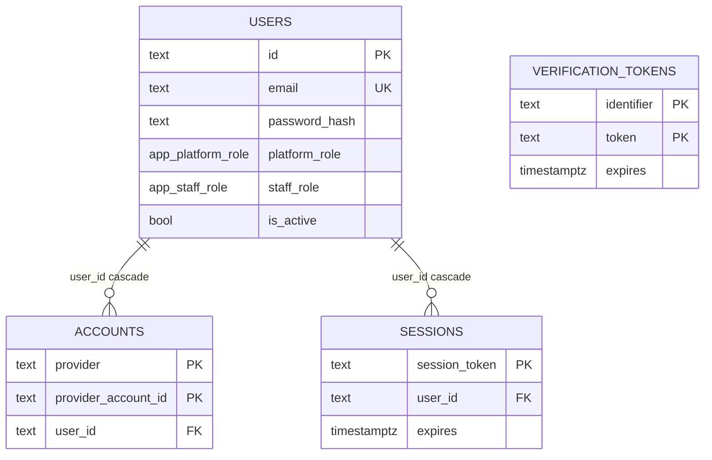

# E4.02 Identity tables: users, accounts, sessions, verification_tokens

Schema file: `src/db/schema/users.ts`. First created by migration `0000_amused_namor.sql`; the mentor
columns arrived in `0001`, and the `lab_admin` staff role in `0006`.

## app.users

Purpose: "the single account record for every human on the platform", staff included
(`users.ts:13-18`). `staff_role IS NOT NULL` is what grants `/admin`; there is no second user table.
Two independent role axes are separate columns (`enums.ts:13-19`) so a person can be, for example, a
founder on the platform and also run mentor review.

| Column | Type | Null | Default | Notes (`users.ts` line) |
|---|---|---|---|---|
| `id` | text | no | app-side `crypto.randomUUID()` | PK (22-24) |
| `email` | text | no | none | UNIQUE constraint `users_email_unique` (27; `0000:51`). Case handling is application-side; the constraint is case-sensitive. Not determined from the schema whether callers lowercase |
| `email_verified` | timestamptz | yes | none | Set by seeds (`seed.ts:145`) and by the verification flow (28) |
| `password_hash` | text | yes | none | "Null for OAuth-only accounts; bcrypt (cost 12) otherwise. Never sent to a client." (29-30). Cost 12 is visible at `seed.ts:114` |
| `name`, `image` | text | yes | none | 31-32 |
| `platform_role` | enum `app.platform_role` | no | `'student'` | 35 |
| `staff_role` | enum `app.staff_role` | yes | none | 37; null for the great majority |
| `bio`, `organization`, `school` | text | yes | none | 40-43 |
| `graduation_year` | integer | yes | none | 44 |
| `linkedin_url`, `website_url` | text | yes | none | 45-46 |
| `skills`, `interests` | text[] | no | `'{}'` | 47-48 |
| `profile_visibility` | enum `app.profile_visibility` | no | `'community'` | 49; public / community / private |
| `goals` | text[] | no | `'{}'` | onboarding step 2 (52); migration 0001 |
| `expertise_areas` | text[] | no | `'{}'` | mentor branch (57); migration 0001 |
| `years_of_experience` | integer | yes | none | 58; migration 0001 |
| `mentor_availability` | enum `app.mentor_availability` | yes | none | 59; migration 0001 |
| `journey_stage` | enum `app.journey_stage` | yes | none | 62 |
| `onboarding_completed_at` | timestamptz | yes | none | 63-66 |
| `is_active` | boolean | no | `true` | 68; deactivation flag, see below |
| `created_at`, `updated_at` | timestamptz | no | `now()` | 69-74 |

Indexes: `users_staff_role_idx (staff_role)`, `users_platform_role_idx (platform_role)` (76-79).
Foreign keys out: none. Foreign keys in: `accounts`, `sessions`, `applications`, `notifications`,
`audit_logs` (restrict), `event_registrations`, `analytics_events` (set null), `enquiries` (two,
set null), `lab_staff`, `lab_bookings` (three), `lab_attendance`, `lab_device_keys` (two),
`lab_scan_events` (three), all listed in files 03 to 05.

Invariants and why:

- **Deactivation, not deletion.** `is_active` is read by the Payload auth bridge on every admin
  request (`src/payload/auth-strategy.ts:44`) and by the Auth.js adapter wrapper
  `src/server/auth/active-only-adapter.ts` (referenced from `src/server/auth/config.ts:10-12`), so an
  account that is switched off loses admin access and sessions on the next request.
- **Role changes take effect on the next request** because both the Auth.js `session` callback
  (`config.ts:40-64`) and the Payload strategy re-read `staff_role` from this table instead of
  trusting a token.
- **At least one active super admin must remain.** Enforced in application code inside a
  transaction (`src/server/members/actions.ts:22,50,91`: `otherActiveSuperAdmins`) and covered by
  `tests/integration/24-last-admin-concurrency.test.ts`; there is no database constraint for it, so
  a direct SQL update can violate it.
- **Profile fields are public-profile precursors.** A mentor's platform account does not become a
  public Mentor profile automatically; staff review the `expertise_areas` etc. before creating a
  `cms.mentors` document (`users.ts:54-56`).

Writers: signup and account actions (`src/server/auth/actions.ts:68,126,175`), member administration
(`src/server/members/actions.ts:54,95`: `is_active`, `staff_role`), onboarding
(`src/server/onboarding/actions.ts:36-129`), seeds (`src/db/seed.ts`, `seed-demo.ts`).
Readers: Auth.js adapter, the Payload bridge, `src/server/members/queries.ts`,
`src/server/admin/overview.ts`, applications review, labs service, notifications.

## app.accounts

Auth.js adapter table for OAuth identities (`users.ts:84-105`). Columns: `user_id` (FK to
`users.id`, ON DELETE CASCADE, not null), `type`, `provider`, `provider_account_id` (all not null),
and nullable `refresh_token`, `access_token`, `expires_at` (integer), `token_type`, `scope`,
`id_token`, `session_state`. Primary key: composite `(provider, provider_account_id)`
(constraint `accounts_provider_provider_account_id_pk`). Index: `accounts_user_id_idx (user_id)`.

Written by the Auth.js `DrizzleAdapter` (`src/server/auth/config.ts:12-17`) when a Google sign-in
links an identity; there is no direct `.insert(accounts)` in `src/`. Read by the same adapter.
The OAuth `access_token`, `refresh_token` and `id_token` are stored as plain text (adapter default).
Whether Google sign-in is enabled in production is a configuration matter (`tests/integration/
46-google-enabled.test.ts`); with it off this table is empty.

## app.sessions

Database sessions, not JWTs (`users.ts:107-122`): "A DB session can be revoked server-side the
instant a role changes or an account is disabled".

| Column | Type | Null | Notes |
|---|---|---|---|
| `session_token` | text | no | PK |
| `user_id` | text | no | FK `users.id` ON DELETE CASCADE; index `sessions_user_id_idx` |
| `expires` | timestamptz | no | 30 days from creation (`config.ts:26` maxAge, `session.ts:46`) |

Written by `createDatabaseSession` (`src/server/auth/session.ts:44-58`): a 32-byte random hex token
is generated, inserted and set as an `httpOnly`, `sameSite=lax` cookie. Deleted on logout
(`session.ts:68`), on password reset (`src/server/auth/actions.ts:179`), on deactivation
(`src/server/members/actions.ts:55`) and on a staff-role change (`members/actions.ts:96`;
`revokeAllSessions`, `session.ts:72-75`). A session read for an inactive user deletes the row
(`active-only-adapter.ts:15-30`).

Note for privacy and security review: the token is stored **as issued**, not hashed, in contrast to
`verification_tokens` below. Anyone with read access to this table can present a live session
cookie. See defect D-04 in `19-defects-and-undetermined.md`. Expired rows are not purged by any job
found in `src/`.

## app.verification_tokens

Single-use e-mail verification and password-reset tokens, reusing the Auth.js table
(`users.ts:124-132`; `src/server/auth/tokens.ts:1-17`).

| Column | Type | Null | Notes |
|---|---|---|---|
| `identifier` | text | no | `"<purpose>:<email>"`, purpose is `verify-email` or `reset-password` (`tokens.ts:22-24`) |
| `token` | text | no | SHA-256 hex digest of the emailed token (`tokens.ts:26-28`) |
| `expires` | timestamptz | no | |

PK: composite `(identifier, token)`. Operations: `issueToken` deletes any outstanding row for the
identifier and inserts a new one (`tokens.ts:30-43`), so a new link invalidates the old.
`consumeToken` is a `DELETE ... RETURNING`, so of two simultaneous uses exactly one succeeds
(`tokens.ts:45-60`). The raw token exists only in the e-mailed link. Note that the e-mailed link
itself is stored in `email_outbox.body` until sent; see `12-email-outbox.md`.

## Data classification

See `18-data-classification.md`. In short: `users` is personal data (and credentials);
`accounts`, `sessions` and `verification_tokens` are authentication material.
