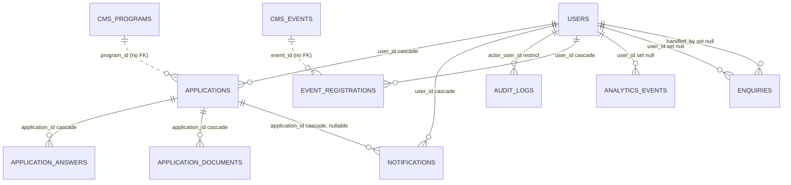

# E4.03 Applications, notifications, audit, events, analytics, enquiries

Schema files: `applications.ts`, `notifications.ts`, `events.ts`, `analytics.ts`, `enquiries.ts` under
`src/db/schema/`. Created by migrations `0002` (applications, answers, documents, notifications,
audit_logs), `0003` (event_registrations), `0004` (analytics_events), `0007` (question_snapshot),
`0008` (enquiries), `0009` (event_registered notification type).

## app.applications

One application by one user to one program. `src/db/schema/applications.ts:15-47`.

| Column | Type | Null | Default | Notes |
|---|---|---|---|---|
| `id` | text | no | app-side UUID | PK |
| `user_id` | text | no | none | FK `users.id` ON DELETE CASCADE |
| `program_id` | integer | no | none | `cms.programs.id`, no FK (see `01`) |
| `status` | enum `app.application_status` | no | `'draft'` | draft, submitted, under_review, shortlisted, interview, accepted, rejected, waitlisted |
| `submitted_at`, `decision_at` | timestamptz | yes | none | |
| `decision_note` | text | yes | none | "Staff-facing only, never surfaced to the applicant" (28) |
| `question_snapshot` | jsonb | yes | none | The program's questions as the applicant saw them at submit; null on drafts and on rows submitted before migration 0007 (30-36) |
| `created_at`, `updated_at` | timestamptz | no | `now()` | |

Indexes: UNIQUE `applications_user_program_idx (user_id, program_id)` (43), `applications_program_idx
(program_id)`, `applications_status_idx (status)`.

Invariants:

- **One application per person per program, enforced by the database.** `startApplication` relies on
  `INSERT ... ON CONFLICT DO NOTHING` against the unique index (`src/server/applications/
  actions.ts:40-80`) instead of check-then-insert; this closed a race found in the phase 5-6
  retrospective.
- **Status transitions are not enforced by the database.** The enum permits any value; the legal
  graph is in `src/server/applications/transitions.ts` and is exercised in
  `tests/integration/60-dependencies-and-migrations.test.ts` ("an illegal transition is refused",
  expects HTTP 400). A direct SQL update bypasses it.
- **The snapshot exists because answers are keyed by question id.** If a program is edited or
  deleted after submission, reviewers still need the original question text (R-04, `applications.ts:30-35`).
  Program deletion with applications is additionally refused by the Programs `beforeDelete` hook.

Writers: `src/server/applications/actions.ts` (insert, update at start, answer, submit),
`src/server/applications/review.ts` (status change, decision note). Readers: the same two files,
`src/server/admin/overview.ts`, `src/server/analytics/funnel.ts`,
`src/payload/collections/programs.ts` (count for the delete guard), and the document download route
`src/app/api/admin/applications/[id]/documents/[questionId]/route.ts`.

## app.application_answers

One row per answered question (`applications.ts:55-72`).

| Column | Type | Null | Default | Notes |
|---|---|---|---|---|
| `id` | text | no | app-side UUID | PK |
| `application_id` | text | no | none | FK `applications.id` CASCADE |
| `question_id` | text | no | none | the stable row id of the program's question |
| `value` | jsonb | no | none | string for text/textarea/select/url, string[] for multiselect |
| `updated_at` | timestamptz | no | `now()` | |

Index: UNIQUE `application_answers_app_question_idx (application_id, question_id)`; autosave is an
upsert on it (`onConflictDoUpdate`, `actions.ts:142`; the answer route is rate limited by `answerSave` per user, `src/app/api/applications/[id]/answer/route.ts:8`, see `11-rate-limit-sql.md`). Written and read only in
`src/server/applications/actions.ts` and `review.ts`.

## app.application_documents

Uploaded files attached to a `file` question (`applications.ts:74-94`).

| Column | Type | Null | Notes |
|---|---|---|---|
| `id` | text | no | PK |
| `application_id` | text | no | FK `applications.id` CASCADE |
| `question_id` | text | no | |
| `file_name` | text | no | the uploader's original name; display only |
| `storage_key` | text | no | "a local path in dev, an S3 key in production" (85); generated server-side (`actions.ts:190`) |
| `mime_type` | text | no | |
| `file_size` | integer | no | bytes |
| `uploaded_at` | timestamptz | no | default `now()` |

Index: UNIQUE `application_documents_app_question_idx (application_id, question_id)`. Re-upload
overwrites the row via upsert (`actions.ts:207-213`) and deletes the previous object
(`actions.ts:218`). Important: `ON DELETE CASCADE` removes the row, **not the S3 object**. The
reconciliation worker (`src/server/storage/reconcile.ts`, started from `src/instrumentation.ts:17-19`)
compares the bucket with this table; it runs as a dry run unless `STORAGE_RECONCILE=apply`.

## app.notifications

In-app notifications (`notifications.ts:13-35`). Every write is paired with an e-mail
(`src/server/notifications/send.ts`).

| Column | Type | Null | Default | Notes |
|---|---|---|---|---|
| `id` | text | no | app-side UUID | PK |
| `user_id` | text | no | none | FK `users.id` CASCADE |
| `type` | enum `app.notification_type` | no | none | 8 values, see `06-enums.md` |
| `title`, `body` | text | no | none | contain rendered copy, may include event titles and locations |
| `href` | text | yes | none | in-app link |
| `application_id` | text | yes | none | FK `applications.id` CASCADE |
| `read_at` | timestamptz | yes | none | |
| `created_at` | timestamptz | no | `now()` | |

Indexes: `notifications_user_idx (user_id)`, `notifications_user_unread_idx (user_id, read_at)`.
Writer: `writeNotification` (`send.ts:27-37`), which accepts a transaction so the row commits with the
status change; the e-mail is sent after commit and never throws (`send.ts:48-62`). Updater:
`src/server/notifications/actions.ts` (mark read, rate limited by `notificationRead`).

## app.audit_logs

Staff audit trail (`notifications.ts:37-60`).

| Column | Type | Null | Notes |
|---|---|---|---|
| `id` | text | no | PK |
| `actor_user_id` | text | no | FK `users.id` ON DELETE **RESTRICT**: a user who has acted cannot be deleted |
| `action` | text | no | free text; see list below |
| `entity_type` | text | no | free text |
| `entity_id` | text | no | free text (not an FK; entities live in both schemas) |
| `before`, `after` | jsonb | yes | "JSON snapshots of just the changed fields, not full row dumps" |
| `created_at` | timestamptz | no | `now()` |

Index: `audit_logs_entity_idx (entity_type, entity_id)`. There is no index on `created_at` or
`action` although the viewer filters and orders on them (`src/server/audit/queries.ts:17-37`); at
present volumes that is not a problem, and it is flagged only for growth.

Action literals found in code (not exhaustive: some are built from template strings, such as
`lab_qr_${action}_verified` at `src/server/labs/attendance-qr.ts:502`):
`application_submitted`, `application_status_changed`, `application_document_viewed`,
`staff_role_changed`, `enquiry_handled`, `email_resent`, `lab_created`, `lab_updated`,
`lab_hours_set`, `lab_blackout_added`, `lab_blackout_removed`, `lab_staff_added`,
`lab_staff_removed`, `lab_booking_cancelled`, `lab_department_created`, `lab_department_updated`,
`lab_department_deleted`, `lab_device_key_registered`, `lab_device_key_revoked`, and CMS actions
`cms.create`, `cms.update`, `cms.publish`, `cms.unpublish`, `cms.delete` (from the Payload hooks,
`src/payload/audit-hooks.ts:30-61`; see `15-payload-globals-hooks-versions.md`). The strings
`approve`, `reject`, `propose` and `create` seen in a literal search belong to lab decisions or other
domains and are not audit actions as such; not determined from this scan.

Invariants: "Every privileged action writes a row in the same transaction as the change"
(`audit/queries.ts:9-13`). The exception is the CMS audit hook, which is deliberately best-effort and
swallows write failures (`audit-hooks.ts:20-28`). The CMS hook also skips any request without a
signed-in staff user (`audit-hooks.ts:11-13,21`), so seeds and migrations leave no audit rows.

Readers: `src/server/audit/queries.ts` (admin viewer, area `audit`, super admin only),
`src/server/admin/overview.ts`, `src/server/labs/service.ts`.

## app.event_registrations

KNEST's own registration list for events it tracks internally (`events.ts:6-35`). Events with a
`registrationUrl` are not counted here (`src/server/events/actions.ts:30-34`).

| Column | Type | Null | Notes |
|---|---|---|---|
| `id` | text | no | PK |
| `user_id` | text | no | FK `users.id` CASCADE |
| `event_id` | integer | no | `cms.events.id`, no FK |
| `registered_at` | timestamptz | no | default `now()` |

Index: UNIQUE `event_registrations_user_event_idx (user_id, event_id)`. Capacity is checked under a
per-event transaction-scoped advisory lock (`pg_advisory_xact_lock`, `events/actions.ts:38-50`)
because counting then inserting let simultaneous requests all take the last seat (R-05).
Rows are not removed if the CMS event is deleted.

## app.analytics_events

Funnel-stage events, "not a click log" (`analytics.ts:5-31`). Server-side only, no third-party SDK
(`src/server/analytics/track.ts:44-52`).

| Column | Type | Null | Notes |
|---|---|---|---|
| `id` | text | no | PK |
| `user_id` | text | yes | FK `users.id` ON DELETE **SET NULL**, deliberately unlike other user-owned tables so counts survive account removal (analytics.ts:6-14) |
| `session_id` | text | no | value of the `knest_sid` cookie, httpOnly, 180 days (`track.ts:5,26-33`) |
| `event` | text | no | e.g. `landing_view`, `program_view`, `search_query`, `application_submit`, `signup` |
| `props` | jsonb | yes | small objects such as `{ programId }`; `search_query` logs a processed search term (`src/app/(public)/search/page.tsx:24`) |
| `created_at` | timestamptz | no | `now()` |

Indexes: `analytics_events_event_idx (event)`, `analytics_events_user_idx (user_id)`. No index on
`created_at` or `session_id`. Writes never throw (`track.ts:44-52`). No retention job was found.

## app.enquiries

Contact-form messages (`enquiries.ts:15-33`). Kept in `app`, not the CMS, because they are personal
data.

| Column | Type | Null | Default | Notes |
|---|---|---|---|---|
| `id` | text | no | app-side UUID | PK |
| `name`, `email`, `message` | text | no | none | free text from a visitor |
| `topic` | enum `app.enquiry_topic` | no | `'general'` | general, program, partnership, mentor, press, support |
| `status` | enum `app.enquiry_status` | no | `'new'` | new, handled |
| `user_id` | text | yes | none | FK `users.id` SET NULL: set when signed in, kept if the account is deleted |
| `created_at` | timestamptz | no | `now()` | |
| `handled_at` | timestamptz | yes | none | |
| `handled_by` | text | yes | none | FK `users.id` SET NULL |

Index: `enquiries_status_created_idx (status, created_at)`. Writers/readers:
`src/server/enquiries/actions.ts` (create, mark handled; the latter writes an audit row
`enquiry_handled`), `src/server/admin/overview.ts`. Admin area `enquiries` is `content_admin` and
`super_admin` (`src/server/auth/roles.ts:22-23`). Public submission is rate limited to 3 per hour per
client address (`src/app/api/enquiries/route.ts:8`, `RATE_LIMITS.enquirySubmit`).

Because `user_id` and the e-mail are both stored, an erasure request for a user must also address
rows where only `email` matches (see `18-data-classification.md`).
