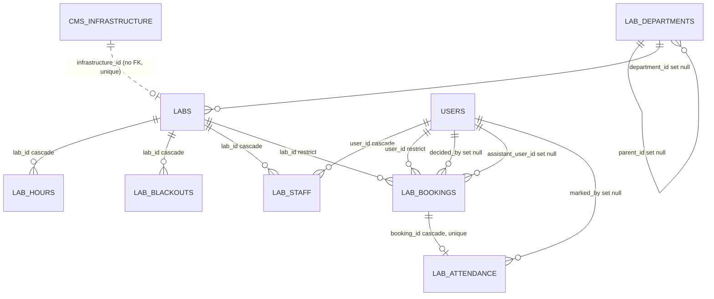
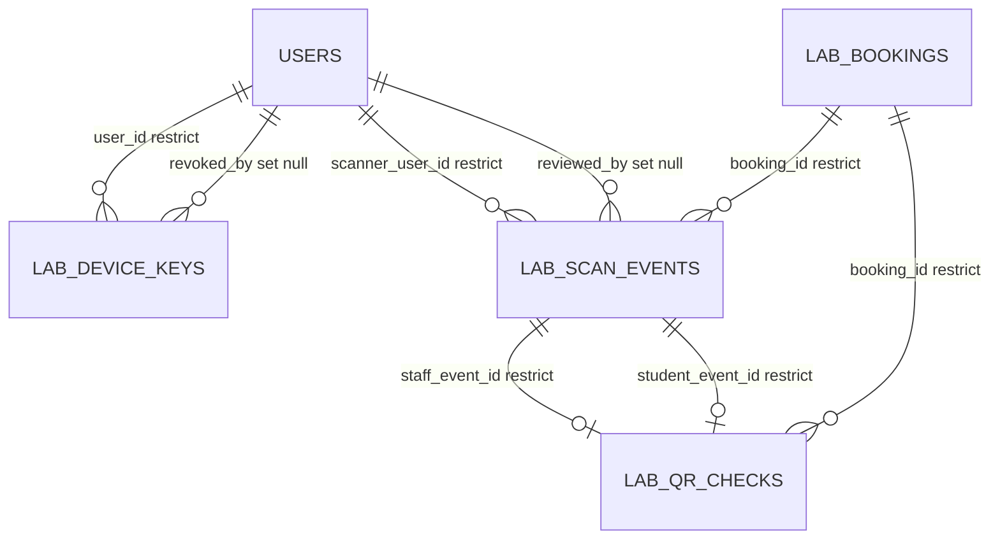

# E4.04 Lab booking and QR attendance tables

Schema files: `src/db/schema/labs.ts`, `src/db/schema/lab-attendance-qr.ts`. Created by migrations
`0010_lab_booking.sql` (core), `0012_lab_departments.sql` (department hierarchy and escalation),
`0013_lab_attendance_qr.sql` (QR attendance). Design notes referenced by the code live in
`docs/delivery/LAB-BOOKING-DESIGN.md` and `docs/delivery/LAB-ATTENDANCE-THREAT-MODEL.md`.

Policy values in `labs` are "recommended defaults from HD-16 and are NOT an approved policy"
(`labs.ts:9-11`). Every operating rule is a column, nothing is hard-coded in the rules code.

## Booking core



### app.lab_departments (`labs.ts:32-42`, migration 0012)

A department hierarchy that is data, not code. Utilisation reports roll a lab's figures up through
every ancestor.

| Column | Type | Null | Default | Notes |
|---|---|---|---|---|
| `id` | text | no | app UUID | PK |
| `slug` | text | no | | UNIQUE `lab_departments_slug_idx` |
| `name` | text | no | | |
| `parent_id` | text | yes | | self-FK `lab_departments.id` ON DELETE SET NULL; index `lab_departments_parent_idx` |
| `created_at` | timestamptz | no | `now()` | |

Invariant: "Cycles are refused by the application (manage.ts); the database only guarantees the
parent exists" (`labs.ts:27-31`). A direct SQL update can create a cycle and would make any recursive
roll-up loop. Deleting a department sets its children's and labs' reference to null (nobody is
orphaned, but the hierarchy flattens silently). Writers: `src/server/labs/department-admin.ts`
(insert, update, delete, each audited as `lab_department_*`).

### app.labs (`labs.ts:44-86`, migration 0010 then 0012)

| Column | Type | Null | Default | Notes |
|---|---|---|---|---|
| `id` | text | no | app UUID | PK |
| `slug` | text | no | | UNIQUE `labs_slug_idx` |
| `name` | text | no | | |
| `department` | text | no | `''` | free-text display label kept for labs not placed in the hierarchy (52) |
| `department_id` | text | yes | | FK `lab_departments.id` SET NULL; index `labs_department_idx`; added 0012 |
| `description` | text | yes | | |
| `infrastructure_id` | integer | yes | | `cms.infrastructure.id`, no FK; UNIQUE `labs_infrastructure_idx` (one lab per CMS space). Postgres unique indexes allow many NULLs |
| `capacity` | integer | no | 1 | CHECK `labs_capacity_positive` (> 0) |
| `slot_minutes` | integer | no | 60 | CHECK `labs_slot_minutes_range` (15..480) |
| `max_consecutive_slots` | integer | no | 3 | CHECK `labs_policy_positive` |
| `min_lead_minutes` | integer | no | 240 | CHECK (>= 0) |
| `max_horizon_days` | integer | no | 14 | CHECK (> 0) |
| `max_open_requests` | integer | no | 3 | CHECK (> 0) |
| `max_hours_per_week` | integer | no | 6 | CHECK (> 0) |
| `cancel_cutoff_minutes` | integer | no | 120 | CHECK (>= 0) |
| `eligibility` | enum `app.lab_eligibility` | no | `'onboarded'` | `verified` (e-mail verified) or `onboarded` (profile complete too); checked at `src/server/labs/service.ts:126-128` |
| `requires_assistant` | boolean | no | false | |
| `escalate_after_hours` | integer | no | 48 | CHECK `labs_escalate_positive` (> 0); added 0012 |
| `is_active` | boolean | no | true | |
| `created_at`, `updated_at` | timestamptz | no | `now()` | |

Check constraints are declared at `labs.ts:81-84`; in SQL they appear at `0010:91-93` and `0012:16`.

### app.lab_hours (`labs.ts:89-103`)

Operating windows in India Standard Time: `weekday` 0 (Sunday) to 6, `opens_minute` and
`closes_minute` as minutes after midnight. Several windows per day are allowed. FK `lab_id` CASCADE.
Index `lab_hours_lab_idx (lab_id, weekday)`. CHECKs: `lab_hours_weekday` (0..6),
`lab_hours_window` (`opens_minute >= 0 and closes_minute <= 1440 and opens_minute < closes_minute`).
Overlapping windows on one day are not prevented by the database; the manage API refuses them with HTTP 400 (`tests/integration/34-lab-booking.test.ts:120-121`). The IST assumption is a code-level
convention; the column carries no zone. Writers: `src/server/labs/manage.ts` (inserts and deletes of hour
windows, audited as `lab_hours_set`).

### app.lab_blackouts (`labs.ts:105-115`)

`starts_on`, `ends_on` (`date`, string mode, inclusive), `reason` text default `''`. FK `lab_id` CASCADE;
index `lab_blackouts_lab_idx (lab_id, starts_on)`; CHECK `lab_blackouts_order (ends_on >= starts_on)`.

### app.lab_staff (`labs.ts:117-128`)

Who runs a lab: `lab_id` (CASCADE), `user_id` (CASCADE), `role` enum `app.lab_staff_role`
(head, assistant), `created_at`. UNIQUE `lab_staff_lab_user_idx (lab_id, user_id)`; index
`lab_staff_user_idx (user_id)`. "A lab role comes only from here; it does not need a staff role in
the console." This is the grant of authority over a lab, independent of `users.staff_role`
(although `lab_admin` exists for the console, `0006`). Writers: `manage.ts`; readers:
`src/server/labs/access.ts`.

Privacy note: because these FKs are CASCADE, removing a user silently removes lab authority, whereas
`lab_bookings.user_id` is RESTRICT.

### app.lab_bookings (`labs.ts:135-167`)

A booking request and its life.

| Column | Type | Null | Default | Notes |
|---|---|---|---|---|
| `id` | text | no | app UUID | PK |
| `lab_id` | text | no | | FK `labs.id` ON DELETE **RESTRICT** ("bookings are history and must outlive an attempt to delete their lab") |
| `user_id` | text | no | | FK `users.id` ON DELETE **RESTRICT** |
| `starts_at`, `ends_at` | timestamptz | no | | CHECK `lab_bookings_time_order (ends_at > starts_at)` |
| `purpose` | text | no | | free text from the member |
| `headcount` | integer | no | 1 | CHECK `lab_bookings_headcount (> 0)` |
| `equipment` | text | yes | | |
| `status` | enum `app.lab_booking_status` | no | `'requested'` | requested, approved, rejected, cancelled, alternative_proposed, completed, no_show |
| `decided_by` | text | yes | | FK `users.id` SET NULL |
| `decided_at`, `decision_note` | timestamptz, text | yes | | |
| `proposed_starts_at`, `proposed_ends_at` | timestamptz | yes | | the head's alternative; CHECK `lab_bookings_proposal_order` |
| `assistant_user_id` | text | yes | | FK `users.id` SET NULL |
| `created_at`, `updated_at` | timestamptz | no | `now()` | |

Indexes: `lab_bookings_lab_start_idx (lab_id, starts_at)`, `lab_bookings_user_idx (user_id,
created_at)`, `lab_bookings_status_idx (status)`, `lab_bookings_assistant_idx (assistant_user_id,
starts_at)`.

**The exclusion constraint** (migration only, `0010_lab_booking.sql:117-119`):

```
ALTER TABLE "app"."lab_bookings" ADD CONSTRAINT "lab_bookings_no_overlap"
  EXCLUDE USING gist ("lab_id" WITH =, tstzrange("starts_at","ends_at") WITH &&)
  WHERE ("status" IN ('requested','approved','alternative_proposed'));
```

Why it exists: the double-booking guarantee must not depend on application code. Rejected,
cancelled, completed and no-show bookings release the slot. It needs the `btree_gist` extension, which
migration 0010 creates (`0010:2`). The application treats SQLSTATE `23P01` as "slot taken"
(`src/server/labs/service.ts:47-50`) and the live status list is mirrored in
`src/server/labs/rules.ts:163`.

Facts that follow from the SQL, stated without interpretation:

- The constraint covers `starts_at`/`ends_at` only. A head's proposed alternative window
  (`proposed_starts_at/ends_at`) is not protected by it.
- It is unconditional on `labs.capacity`: two live bookings of one lab may never overlap, whatever
  the lab's capacity or headcount.
- It is not represented in the Drizzle schema or in any drizzle-kit snapshot
  (`src/db/migrations/meta/0010_snapshot.json` contains no exclusion entry; `labs.ts:131-133`
  documents that "drizzle cannot express it"). It lives only in the SQL file. A database built from
  the TypeScript schema alone (for example via `drizzle-kit push`) would not have it.
- `cms.lab_bookings` was an earlier, abandoned CMS collection and was dropped by Payload migration
  `20261009_083013_drop_cms_lab_bookings` (see `08-payload-migrations.md`). The authoritative booking
  table is this one.

Concurrency: the request path takes `SELECT ... FOR UPDATE` on the requesting user's row so a person's
checks and insert run serialised (`service.ts:135`), counts open requests and weekly hours inside the
transaction (`service.ts:137-150`), and the exclusion constraint has the last word on overlap.

### app.lab_attendance (`labs.ts:169-182`)

Manual attendance by an assistant or head.

| Column | Type | Null | Default | Notes |
|---|---|---|---|---|
| `id` | text | no | app UUID | PK |
| `booking_id` | text | no | | FK `lab_bookings.id` CASCADE; UNIQUE `lab_attendance_booking_idx` (one outcome per booking) |
| `outcome` | enum `app.lab_attendance_outcome` | no | | attended, no_show |
| `marked_by` | text | yes | | FK `users.id` SET NULL |
| `marked_at` | timestamptz | no | `now()` | |
| `reason` | text | yes | | |
| `method` | text | no | `'manual'` | free text; a QR path also writes here |

Writers: `src/server/labs/service.ts` (manual) and `src/server/labs/attendance-qr.ts` (QR). There is
no `.from(labAttendance)` read in `src/`; attendance is read through joins (not determined further).

## QR attendance

Assurance level is "record attendance"; "nothing here opens a door" (`lab-attendance-qr.ts:7-15`).
The feature is gated by `FEATURE_LAB_ATTENDANCE_QR` (default off, also requires `FEATURE_LAB_BOOKING`)
and needs the threat model signed off before enabling. The tables exist in every database regardless
of the flag, because migration 0013 is unconditional. No personal data is placed in a QR payload.



### app.lab_device_keys (`lab-attendance-qr.ts:22-46`)

A device public key; one person may have several, and a key belongs to a person, never to a shared
tablet (threat T11).

| Column | Type | Null | Notes |
|---|---|---|---|
| `id` | text | no | PK; first 12 bytes of SHA-256 of the raw public key, base64url, 16 characters; CHECK `lab_device_keys_id_shape (char_length(id) = 16)` |
| `user_id` | text | no | FK `users.id` RESTRICT; index `lab_device_keys_user_idx` |
| `public_key` | text | no | 65-byte uncompressed P-256 point, base64url; UNIQUE `lab_device_keys_public_key_idx` |
| `label` | text | no | default `''` |
| `created_at` | timestamptz | no | `now()` |
| `last_used_at`, `revoked_at` | timestamptz | yes | |
| `revoked_by` | text | yes | FK `users.id` SET NULL |
| `revoked_reason` | text | yes | |

Public keys and key ids are not secret. Registration and revocation are audited
(`lab_device_key_registered`, `lab_device_key_revoked`, `attendance-qr.ts:76,118`).

### app.lab_scan_events (`lab-attendance-qr.ts:48-94`)

Every scan event the server has seen from a signed-in submitter, append-only, with its signed token
kept so a dispute can be settled from the record (T12). The server decides `status`.

| Column | Type | Null | Notes |
|---|---|---|---|
| `id` | text | no | PK; UUID chosen by the scanning device, the idempotency key of its outbox |
| `booking_id` | text | no | FK `lab_bookings.id` RESTRICT |
| `side` | enum `app.lab_scan_side` | no | staff, student |
| `action` | enum `app.lab_scan_action` | no | in, out |
| `scanner_user_id` | text | no | FK `users.id` RESTRICT |
| `scanner_key_id` | text | no | not an FK to `lab_device_keys` |
| `inner_key_id`, `inner_user_id`, `inner_nonce` | text | yes | parsed from the scanned pass or challenge; `inner_user_id` is not an FK |
| `inner_step` | bigint (number mode) | yes | |
| `token` | text | no | the signed scan token verbatim |
| `status` | enum `app.lab_scan_status` | no | accepted, review, rejected |
| `code` | text | yes | reject or review reason code |
| `client_at_ms`, `client_sync_at_ms` | bigint | no | scanner clock at scan and at submit; CHECK `lab_scan_events_client_times` (both > 0) |
| `effective_at` | timestamptz | yes | scan time on the server timeline after skew correction |
| `received_at` | timestamptz | no | `now()` |
| `reviewed_by` | text | yes | FK `users.id` SET NULL |
| `reviewed_at`, `review_note` | timestamptz, text | yes | |

Indexes: `lab_scan_events_booking_idx (booking_id, action)`, `lab_scan_events_review_idx (status,
received_at)`, `lab_scan_events_scanner_idx (scanner_user_id, received_at)`, and two **partial unique
indexes** that implement single-use nonces:

- `lab_scan_events_staff_nonce_idx (inner_key_id, inner_nonce) WHERE side = 'staff' AND status <> 'rejected'`
- `lab_scan_events_student_nonce_idx (scanner_key_id, inner_nonce) WHERE side = 'student' AND status <> 'rejected'`

Replay is therefore refused by the database: a student pass nonce is single use, and a student scans a
given desk challenge once. Rejected events are excluded so a failed attempt does not burn a nonce.
Unlike the exclusion constraint, these partial indexes are declared in Drizzle
(`lab-attendance-qr.ts:86-91`) and generated into migration 0013 lines 68-69.

### app.lab_qr_checks (`lab-attendance-qr.ts:96-116`)

The outcome per booking and direction. `verified` only when the server accepted both a staff-side and
a student-side event inside the pair window; "the interface never says verified before this".

| Column | Type | Null | Notes |
|---|---|---|---|
| `id` | text | no | PK, app UUID |
| `booking_id` | text | no | FK `lab_bookings.id` RESTRICT |
| `action` | enum `app.lab_scan_action` | no | |
| `state` | enum `app.lab_qr_check_state` | no | partial_staff, partial_student, verified |
| `staff_event_id`, `student_event_id` | text | yes | FK `lab_scan_events.id` RESTRICT |
| `verified_at` | timestamptz | yes | |
| `updated_at` | timestamptz | no | `now()` |

UNIQUE `lab_qr_checks_booking_action_idx (booking_id, action)`. CHECK `lab_qr_checks_verified_has_both`:
`state <> 'verified' OR (staff_event_id IS NOT NULL AND student_event_id IS NOT NULL AND verified_at IS
NOT NULL)`. This makes "verified without both scans" unrepresentable.

Writers and readers for all QR tables: `src/server/labs/attendance-qr.ts` only (plus the
`src/app/api/lab-attendance/*` routes calling it). Verification writes an audit row
`lab_qr_<action>_verified` in the same transaction (`attendance-qr.ts:502`).

Privacy note: `lab_scan_events` retains who scanned, when, and the device key id. Every foreign key to
`users` here is RESTRICT, so these rows block any user deletion and would have to be anonymised in
place for an erasure. No retention job exists in the repository.
