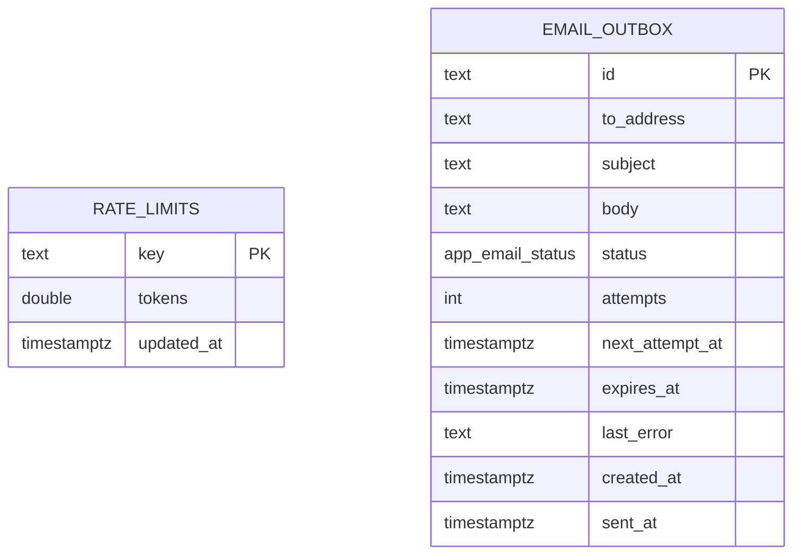

# E4.05 Platform tables: rate_limits and email_outbox

Two `app` tables carry no business domain. Both stand alone (no foreign keys), both are written on hot
paths, and both are addressed by strings rather than by user ids. Behaviour is covered in
`11-rate-limit-sql.md` and `12-email-outbox.md`; this file is the column reference.

## app.rate_limits

Source: `src/db/schema/security.ts:11-15`, migration `0005_warm_outlaw_kid.sql`.

| Column | Type | Null | Default | Notes |
|---|---|---|---|---|
| `key` | text | no | none | PK. Bucket identity: `${route}:${ip}` for anonymous routes, `${route}:${userId}` for authenticated ones (`security.ts:4-9`). Examples in code: `enquiry:${ip}` (`src/app/api/enquiries/route.ts:8`), `application-start:${userId}` (`src/server/applications/actions.ts:67`) |
| `tokens` | double precision | no | none | A float: "a continuously-refilling fractional value", not a count. May reach `-1` (see `11`) |
| `updated_at` | timestamptz | no | `now()` | Time of the last check; the refill is computed from it |

No secondary indexes (the PK is the only lookup). **No cleanup job exists**: a search of `src/` and
`scripts/` finds `rate_limits` only in the schema file, the SQL in `rate-limit.ts`, and migration
files. Every distinct key ever used leaves a row. Keys embed client IPs for anonymous routes, so this
table accumulates IP addresses without a retention limit (see `18-data-classification.md`, defect
D-03).

Reader/writer: `src/server/security/rate-limit.ts` only, through raw SQL (`app.rate_limits` is not
referenced through the Drizzle table object anywhere in `src/`).

Account-level sign-in throttling uses a hashed e-mail in the key (comment at `rate-limit.ts:15-17`,
"hashed e-mail"), so that table content does not hold raw addresses for that bucket. The hashing code
is outside the files reviewed here; not determined further.

## app.email_outbox

Source: `src/db/schema/email-outbox.ts:4-34`, migration `0011_email_outbox.sql`. Durable outgoing
mail: "A message is written here BEFORE it is handed to the provider".

| Column | Type | Null | Default | Notes |
|---|---|---|---|---|
| `id` | text | no | app UUID | PK |
| `to_address` | text | no | none | recipient e-mail, retained for the life of the row |
| `subject` | text | no | none | |
| `body` | text | no | none | plain text; "can contain a single-use link". Blanked to `''` when sent or expired, and 7 days after creation for dead rows (`outbox.ts:134-136`). `NOT NULL`, so "blank" is the empty string |
| `status` | enum `app.email_status` | no | `'pending'` | pending, sent, expired, dead |
| `attempts` | integer | no | 0 | failed attempts so far |
| `next_attempt_at` | timestamptz | no | `now()` | doubles as the processing lease (`outbox.ts:22,148`) |
| `expires_at` | timestamptz | no | none | after this the message is not sent |
| `last_error` | text | yes | none | bounded to 300 chars, addresses masked (`outbox.ts:30-34`) |
| `created_at` | timestamptz | no | `now()` | |
| `sent_at` | timestamptz | yes | none | |

Index: `email_outbox_due_idx (status, next_attempt_at)`, shaped for the worker's "pending and due"
scan.

There is no foreign key to `users`. A user's mail can be located only by `to_address`.

Rows are never deleted by code: `sent`, `expired` and (after 7 days) `dead` rows keep `to_address`,
`subject` and `last_error` indefinitely. Only the `body` is blanked.
