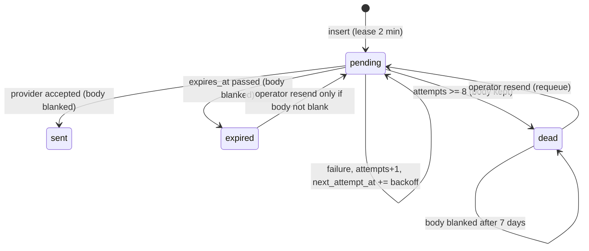

# E4.12 The e-mail outbox

Code: `src/server/email/outbox.ts` (queue and worker), `src/server/email/send.ts` (public entry and
transports), `src/server/email/admin.ts` (operator list and resend), table `app.email_outbox`
(`05-platform-tables-rate-limits-and-mail.md`). Migration `0011_email_outbox.sql`.

## 1. Why it exists

Before it, a provider outage, a missing sender identity or a restart lost a verification or password
reset link, and the user had no recourse (`email-outbox.ts:6-10`). Now a message is written to the
database **before** it is handed to the provider; a worker retries with growing delay until the
message is sent, runs out of attempts or passes `expires_at`.

## 2. Producer path

`sendEmail(message, { ttlMs })` (`send.ts:64-67`) calls `sendDurably` (`outbox.ts:70-91`):

1. Insert a row: `to_address`, `subject`, `body = text`, `next_attempt_at = now + 2 min` (the lease for
   the immediate attempt), `expires_at = now + ttl` (default 24 h, `DEFAULT_TTL_MS`).
2. If the insert fails (database down), log `email_outbox_unavailable` and call `sendEmailDirect`; that
   error then reaches the caller. This is the only path where a send error propagates.
3. Otherwise make the first attempt immediately in the same request. Once the row is stored
   `sendDurably` never throws.

Callers: sign-up verification, resend verification, password reset (`src/server/auth/actions.ts:80,
114,150`), notifications (`src/server/notifications/send.ts:54`), enquiry mail
(`src/server/enquiries/actions.ts:28`, purpose not reviewed), event registration through `notify`.

Transports (`send.ts:1-10`): `EMAIL_TRANSPORT=ses` (SES v2 through the host IAM role, no stored SMTP
credentials), else SMTP when `SMTP_HOST` is set, else the message is logged to the console. In the
console mode the "send" succeeds and the row is marked `sent`, so local development still exercises
the outbox lifecycle.

## 3. State machine

Rules in code:

| Rule | Value | Where |
|---|---|---|
| Max attempts | 8; the 8th failure marks the row `dead` | `outbox.ts:21,52` |
| Backoff after failure n (1..7) | 1 min, 5 min, 15 min, 1 h, 3 h, 6 h, 12 h | `outbox.ts:23-28` |
| Lease while processing | 2 min | `outbox.ts:22,148` |
| Default TTL | 24 h | `outbox.ts:20` |
| Dead body retention | 7 days from `created_at` | `outbox.ts:18,133-136` |
| Worker interval | 30 s, guarded against overlap, `unref`'d | `outbox.ts:166-178` |
| Batch size | 20 rows per tick | `outbox.ts:132` |

Arithmetic: the sum of the seven backoffs is 22 h 21 min, below the 24 h TTL, so under defaults a
persistently failing message reaches `dead` by attempt count just before `expires_at`. A shorter TTL
(`ttlMs` option) would end in `expired` first.

Differences between end states:

- `sent` and `expired`: body set to `''` immediately (`outbox.ts:41,55,154`), because it may hold a
  live single-use link.
- `dead`: body kept so an operator can resend; the worker blanks it once the row is older than 7 days
  from **creation** (`lt(createdAt, now - 7d)`), not from the time it died. Under default TTL they are
  within a day of each other.

## 4. Worker and concurrency

`processDue` (`outbox.ts:132-161`):

1. Blank bodies of dead rows older than 7 days.
2. In a transaction: select up to 20 `pending` rows with `next_attempt_at <= now`, ordered by
   `next_attempt_at`, `FOR UPDATE SKIP LOCKED`; update their `next_attempt_at` to `now + 2 min` and
   return the data. This claim-by-lease is what lets several containers (and the creating request)
   run without double sending.
3. Outside the transaction, for each claimed row: mark `expired` if past `expires_at`, else `attempt`.

Crash behaviour: a process that dies mid-send leaves the row `pending` with the lease; it becomes due
again after at most 2 minutes and is sent by another worker. This is at-least-once delivery: a
provider call that succeeded but whose `UPDATE ... status = 'sent'` failed would be sent again.

`attempt` (`outbox.ts:38-67`): on success mark `sent`, set `sent_at`, blank body, clear `last_error`.
On failure increment `attempts` atomically (`SET attempts = attempts + 1 ... RETURNING`), store a
sanitised `last_error` (single line, e-mail addresses replaced by `<address>`, 300 chars,
`describeError`), then either mark `expired` / `dead` and log `email_outbox_dead`, or set the next
attempt time and log `email_outbox_retry`.

**The worker only runs in a production process.** `startOutboxWorker` is called from
`src/instrumentation.ts:13-15` after `shouldCheckEnv`, which returns false unless
`NODE_ENV === 'production'`, not a build phase and not a Vercel preview (`server/env.ts:105-110`). In
development and tests the first attempt is made in-request but nothing retries.

## 5. Operator resend

`requeue(id, actorUserId)` (`outbox.ts:100-129`):

- Opens a transaction, locks the row `FOR UPDATE` so two operators pressing Resend send it once.
- Only `dead` or `expired` rows with a non-empty body are resendable; results `not_found`,
  `not_resendable`, `no_body`, `queued`.
- Resets `status = pending`, `attempts = 0`, `last_error = null`, new lease, new 24 h `expires_at`;
  writes an `audit_logs` row `email_resent` (entity `email_outbox`) in the same transaction;
  then makes one attempt immediately.

Listing (`admin.ts:24-50`): requires admin area `mail` (super admin only,
`src/server/auth/roles.ts:29-30`); never returns `body`; computes `resendable` in SQL; filters
attention (dead and expired), pending, sent, all; 25 per page.

## 6. Data protection facts

- The table holds recipient addresses and subjects for every message ever sent, with no deletion.
  Only the body is blanked. Subjects can contain event titles or application program names (templates
  in `src/server/notifications/templates.ts` and `src/server/email/templates.ts`; contents not
  reviewed here).
- Until sent or expired, `body` holds the live verification or reset URL in clear. The token in it is
  the raw value; the hash is what `app.verification_tokens` stores (`tokens.ts:1-17`). A reader of
  the outbox during that window can complete a reset. This is why the admin list hides the body and
  why the area is super-admin only.
- The `ses` transport sets a configuration set only if one is supplied (`send.ts:30`).
