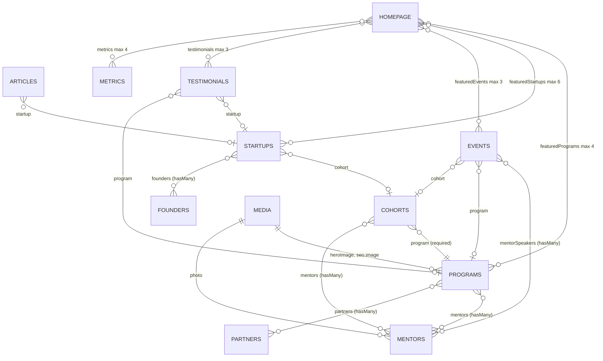

# E4.14 Payload collections: fields, relations, hooks

Source: `src/payload/collections/*.ts`, shared fields `src/payload/fields/*.ts`. Access rules are in
`13-payload-config-and-access.md`. Table names and columns in `cms` come from the baseline migration
(`08-payload-migrations.md`). "Drafts" means `versions: { drafts: true }`, which adds `_status`
(`draft` default or `published`) to the main table and a `_<slug>_v` table.

## Relationship graph

Uploads to `media` are used by programs (`heroImage`, `seo.image`), startups (`logo`, `coverImage`),
founders and mentors (`photo`), partners (`logo`), events (`heroImage`, `speakers[].photo`),
resources (`file`), articles (`heroImage`), infrastructure (`images`, hasMany), testimonials
(`photo`) and the homepage (`heroMedia`). Single uploads are `<field>_id integer` columns with FK
`ON DELETE set null`, so deleting a media item blanks references rather than failing.

## Shared fields

| Field helper | File | Behaviour |
|---|---|---|
| `slugField(from)` | `fields/slug.ts:11-34` | `text`, required, unique, indexed, sidebar. `beforeValidate`: derived from the source field only when blank **and** operation is `create`, via `slugify` (lowercase, non-alphanumerics to `-`, trimmed, capped at 80 chars). Never re-derived on update so shared URLs do not break |
| `seoField` | `fields/seo.ts:8-22` | `group` `seo`: `title` (max 70), `description` (max 180), `image` (upload `media`). Stored as `seo_title`, `seo_description`, `seo_image_id` |
| taxonomy | `fields/taxonomy.ts` | `STAGE_OPTIONS` (7), `SECTOR_OPTIONS` (15), `AUDIENCE_OPTIONS` (5), `FORMAT_OPTIONS` (3), `EXPERTISE_OPTIONS` (9). One vocabulary used by programs, startups, resources, events, mentors |

Slug uniqueness is enforced by a unique index in the database for the nine slugged collections.
Because the check is on `slug` alone, a draft and a published document cannot share a slug.

## Collections

### programs (`programs.ts`) - drafts, 255 lines

Purpose: the product of the public site. Field order mirrors the page order.

- Top level: `title` (req), `slug`, `tagline` (req, max 120).
- Tab "The page": `whoItsFor` richText (req), `whatYoullBuild`, `whatYoullGet`, `requirements`
  richText; `timeline[]` (`label` req, `description`, `duration`); `faqs[]` (`question`, `answer`
  richText, both req).
- Tab "Who it reaches": `stage` multi-select (req, indexed), `sectors` (indexed), `audience`,
  `format` (default `in_person`).
- Tab "Running it": `duration`, `cohortSize` (min 1), `nextCohortStart`, `applicationStatus`
  (req, default `closed`, indexed: open, opening_soon, closed, in_progress), `applicationDeadline`
  (shown only when open), `applicationOpensAt` (only when opening_soon), `mentors`, `partners`.
- Tab "Application": `applicationQuestions[]`: `label` (req), `helpText`, `fieldType` (req, default
  `text`: text, textarea, select, multiselect, url, file), `options[]` (`label`, `value`; `value`
  auto-filled from `slugify(label)` by a `beforeValidate` field hook when blank, only shown for
  select types), `required` (default true), `maxLength` (text types).
- Tab "SEO": `seoField`. Sidebar: `heroImage`, `featured` (default false).
- Hook: `beforeDelete` refuses with HTTP 409 when `app.applications` has any row for the program id:
  "This program has N application(s) and cannot be deleted. Unpublish it instead." (`programs.ts:39-59`).
  The query is a Drizzle call from inside the CMS (`db.select(count()).from(applications)`). The id is
  converted with `Number(id)`.
- Invariants: each array entry gets a stable `varchar` id, which is what `application_answers.question_id`
  stores; reordering or editing never detaches answers. An option's `value` is the stable stored
  answer; editing the label does not change it (`programs.ts:213-225`). Deleting a question row still
  leaves orphaned answers; `applications.question_snapshot` is what keeps review readable.

### cohorts (`cohorts.ts`) - no drafts

`name` (req), `program` (rel programs, req, indexed), `startsAt`, `endsAt`, `status` (select upcoming
/ in_progress / completed, default upcoming), `mentors` (rel mentors, hasMany). The join that lets a
startup name its cohort and a program page list its startups (spec 23).

### startups (`startups.ts`) - drafts

`name` (req), `slug`, `tagline` (req, max 120), `story[]` (`stage` req: problem, idea, experiment,
product, progress; `heading` req; `body` richText req), `stage` (indexed), `sectors` (indexed),
`cohort` (rel cohorts, indexed), `founders` (rel founders, hasMany), `school`, `foundedYear` (2000 to
2100), `websiteUrl`, `achievements[]` (`label` req, `date`), `logo`, `coverImage`, `featured`, SEO.
Rule in the file header: every field is public once published; private operational data "must never be
added to this collection".

### founders (`founders.ts`) - drafts

`name` (req), `slug`, `headline` (max 120), `bio`, `school`, `graduationYear`, `linkedinUrl`, `photo`,
`userId` (text, indexed, sidebar; optional link to `app.users.id`). Exists separately from `app.users`
so a profile can precede an account and survive its deletion.

### mentors (`mentors.ts`) - drafts

`name` (req), `slug`, `title`, `organization`, `bio`, `expertise` (multi-select, req, indexed),
`sectors`, `availability` (open / limited / unavailable, default limited), `linkedinUrl`, `photo`,
`featured`, `userId` (text, indexed). Staff-created only ("KNEST vouches for who appears here").

### partners (`partners.ts`) - drafts

`name` (req), `slug`, `type` (industry, academic, government, investor, community), `description`,
`websiteUrl`, `logo`.

### events (`events.ts`) - drafts

`title`, `slug`, `summary` (req, max 200), `description` richText, `startsAt` (req, indexed),
`endsAt`, `eventType` (workshop default, talk, ideation, demo_day, networking, hackathon,
office_hours), `format` (default in_person), `location`, `registrationUrl`, `capacity` (min 1),
`mentorSpeakers` (rel mentors, hasMany), `speakers[]` (`name` req, `title`, `organization`, `photo`),
`relevantStages`, `sectors`, `program`, `cohort`, `heroImage`, `featured`, SEO.
`registrationUrl` decides whether KNEST counts registrations itself (`app.event_registrations`) or
links out (`src/server/events/actions.ts:30-34`); `capacity` is enforced against that table.

### resources (`resources.ts`) - drafts

`title`, `slug`, `summary` (req, max 200), `format` (req, default guide: guide, template, playbook,
video, article, worksheet), `stages` (multi-select, req, indexed), `topics` (sector options), `body`
richText, `externalUrl`, `file` (upload media), `readingMinutes` (min 1), `featured`, SEO. Indexed
by stage, not topic, so a founder's stage leads to the right material.

### articles (`articles.ts`) - drafts

`title`, `slug`, `summary` (req, max 200), `body` richText (req), `publishedAt` (indexed), `author`
(plain text), `startup` (rel), `heroImage`, SEO.

### infrastructure (`infrastructure.ts`) - drafts

`name` (req), `slug`, `summary` (max 200), `description` richText, `spaceType` (9 options named from
KNEST's own list), `location`, `capacity` (min 1), `equipment[]` (`item` req), `images` (hasMany
media). Showcase only; booking lives in `app.labs`, which links back through `labs.infrastructure_id`.

### testimonials (`testimonials.ts`) - no drafts

`quote` (req, max 400), `attribution` (req), `role`, `photo`, `startup`, `program`, `consentGiven`
(checkbox, **required**). Required means the field must be present; Payload's `required` on a
checkbox does not by itself force `true` (not determined from the code whether the admin UI blocks
saving an unchecked box). Because the collection is `readAlways` there is no draft state: a saved
testimonial is immediately public.

### faqs (`faqs.ts`) - no drafts

`question` (req), `answer` richText (req), `category` (general default, programs, applications,
eligibility, mentorship), `order` (default 0).

### metrics (`metrics.ts`) - no drafts

`label`, `value` (text, e.g. "12" or a rupee figure), `asOf` (date, req), `source` (text, req, field
read restricted to `content`), `order`. "A metric with no date and no source is indistinguishable from
one somebody made up" (file header). Public read, so `label`, `value` and `asOf` are public the moment
a row is saved.

### media (`media.ts`) - no drafts

See `17-media-and-s3-storage.md`. Fields `alt` (req), `credit`; upload settings and size variants.

### staff (`staff.ts`) - mirror

`id` (text, req, custom), `email` (req), `name`, `staffRole` (text). Auth strategies:
`disableLocalStrategy: true`, `strategies: [authJsStrategy]`. Hidden in admin. Access: read for any
staff; create, update, delete and unlock always false. See `16-auth-bridge.md`.

## Deletion behaviour summary

| Collection | Delete guard | What breaks on delete |
|---|---|---|
| programs | yes: 409 when applications exist | nothing (blocked) |
| events | none | `app.event_registrations` rows keep a dangling `event_id`; the member dashboard must tolerate it (not determined) |
| infrastructure | none | `app.labs.infrastructure_id` dangling |
| mentors, founders | none | `userId` is only a text link; `rels` rows pointing at the deleted mentor are removed by FK cascade (baseline `programs_rels_mentors_fk`) |
| any with versions | none | The version table FK `_<slug>_v.parent_id` is ON DELETE SET NULL (baseline line 1036 for programs), so the database alone would leave orphaned version rows; removal of versions on delete is Payload behaviour, not determined from this repo |
