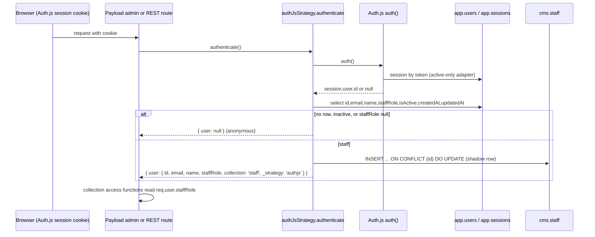

# E4.16 The Auth.js to Payload bridge

Files: `src/payload/auth-strategy.ts`, `src/payload/collections/staff.ts`,
`src/server/auth/config.ts`, `src/server/auth/active-only-adapter.ts`. Called "the one genuinely
risky decision in this architecture" in the file header (`auth-strategy.ts:8-9`).

## 1. Problem and solution

Payload wants to own a users collection and a login form. That would give two account systems for
one person. Instead:

- Accounts live only in `app.users`; sessions only in `app.sessions` (Auth.js, database strategy).
- The `staff` collection is an auth-enabled shell with `disableLocalStrategy: true`, so Payload's own
  e-mail and password login does not exist (`staff.ts:22-27`).
- The one strategy on it, `authjs` (`auth-strategy.ts:22-80`), turns the Auth.js session into a
  Payload `req.user`.
- Payload's collection access then runs on `req.user.staffRole` (`access.ts:5-8`).

## 2. Step by step (`authenticate`)

1. `auth()` (Auth.js) resolves the session cookie through the adapter. A deactivated user's session
   row is deleted on read (`active-only-adapter.ts:15-30`), so step 1 already yields null for them.
2. No session, no `session.user.id`: `{ user: null }` (line 26).
3. **Re-read the role from the database** (lines 28-39): the staff role "is re-read ... rather than
   trusted from the session payload, so revoking staff access takes effect on the next request"
   (lines 41-43).
4. Not found, `is_active = false`, or `staff_role IS NULL`: `{ user: null }` (line 44). Payload then
   treats the request as anonymous and its access functions refuse. A student who guesses the URL
   gets nothing even if the Next.js route layer were bypassed.
5. **Shadow upsert** (lines 50-64): raw SQL
   `INSERT INTO "cms"."staff" (id, email, name, staff_role, created_at, updated_at) VALUES (...)
   ON CONFLICT (id) DO UPDATE SET email, name, staff_role, updated_at = NOW()`. Reason (lines 46-49):
   Payload's preferences and relational fields need a real row for foreign keys
   (`payload_preferences_rels.staff_id`, `payload_locked_documents_rels.staff_id`). A raw upsert is
   used so it does not slow every request. Errors are caught and logged
   (`[authJsStrategy] Failed to sync shadow staff record`) and do not fail the request.
6. Returns the user object with `collection: 'staff'` and `_strategy: 'authjs'`; timestamps converted
   to ISO strings because Payload's generated type requires them (lines 66-77).

## 3. Properties and invariants

- **Authorization is on the server, per request.** Nothing about the role is cached in a token.
  Demotion, deactivation and role changes take effect on the next request; additionally
  `revokeAllSessions` is called on role change and deactivation (`members/actions.ts:55,96`).
- **Fail closed**: every missing or inactive path yields anonymous, and anonymous is denied by
  `canWrite` and by `readPublished` (published only).
- **Two reads and one write per admin request**: a session lookup, a user select, and the shadow
  upsert. REST calls from the admin UI each pay this. Hence `staff` is excluded from audit hooks.
- **`cms.staff` is a cache, not a source of truth.** `id` is the `app.users.id` UUID (custom `text`
  id, `staff.ts:41-44`), `staff_role` is a plain `varchar`, and nothing enforces it matches.
- **Write paths to the mirror are closed**: `create`, `update`, `delete` are `() => false` and
  `unlock` is `() => false` (`staff.ts:29-39`). The strategy's raw SQL is the only writer, and it
  bypasses Payload access by design.

## 4. Failure modes an operator may see

| Symptom | Likely cause |
|---|---|
| Staff user lands on the public site or 401 on `/api/*` | `is_active` false, `staff_role` null, or session expired |
| Admin works but preferences or locks error with FK violation | shadow upsert failed (see console log line above): `cms.staff` missing, column rename, or privilege missing for the runtime role on `cms` |
| Role change not reflected | not possible by design except within the same request; check `app.users.staff_role` |
| Everything anonymous after upgrading Next or Auth.js | `auth()` no longer resolves in the Payload request context; `authenticate` takes no arguments and relies on `auth()` reading cookies from the ambient request |

## 5. Weak points

- **Ex-staff stay in `cms.staff`.** Rows are never deleted. A person who loses the staff role keeps
  their e-mail, name and last role there, readable by every current staff user through `/api/staff`
  (`read: isStaff`). Not covered by any erasure or deactivation path found.
- **A stale `staff_role` value** is stored for them as well. Harmless to access (it is read from
  `app.users`), but misleading.
- **No unique constraint on `cms.staff.email`**: `id` is the conflict target. Two ids with one e-mail
  cannot occur while `app.users.email` is unique.
- **Truncated comment** at `auth-strategy.ts:66` ("They are the", sentence unfinished): cosmetic
  defect D-10.
- **Console-only error signal** for a failed upsert: no metric or alert is raised from this code.
